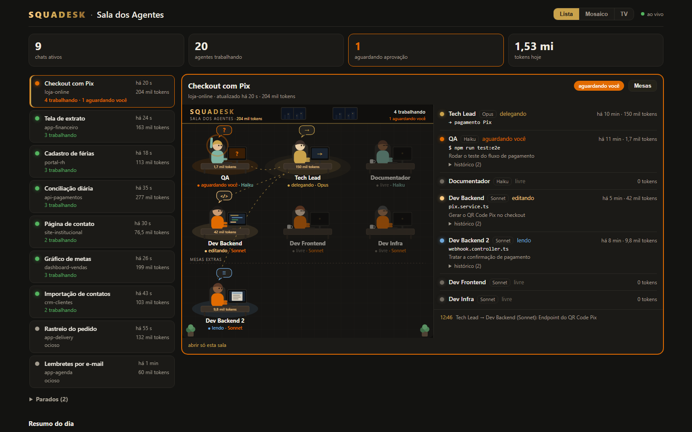
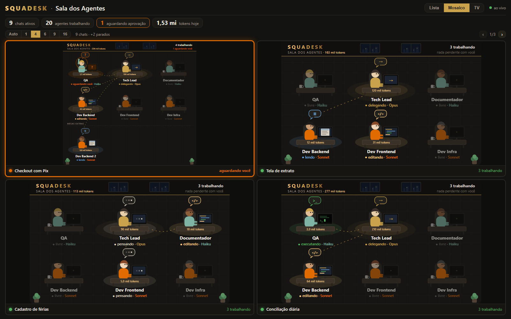
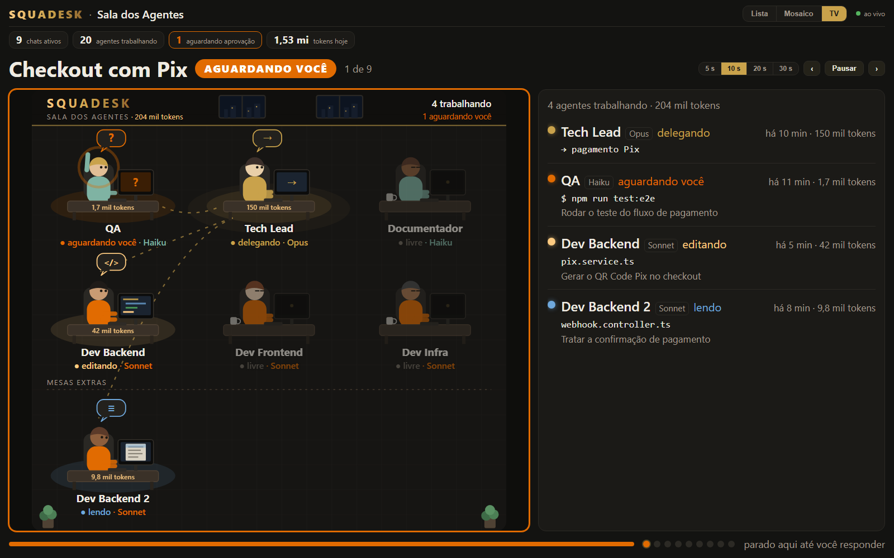

# Squadesk · Sala dos Agentes

Painel ao vivo dos agentes do Claude Code. O Tech Lead e os subagentes aparecem como personagens numa sala, cada um na mesa do seu papel. Em cada mesa você vê o que o agente está fazendo, quanto gastou de tokens, há quanto tempo está na tarefa e se espera sua aprovação. Um painel web reúne as salas de todos os chats da máquina, para ver no PC, no celular ou numa TV da rede.



## O que faz

- **Sala no chat (`/sala`):** desenho da equipe com atividade, arquivo ou comando atual, tokens, cronômetro, histórico por agente e eventos.
- **Mesas por projeto:** a equipe (nome, modelo e palavras-chave de cada mesa) vem de um `sala-agentes.json`. Cada subagente senta na mesa do seu papel. Os que sobram vão para mesas extras, e um papel que não está na equipe ganha uma mesa temporária.
- **Guia automático:** no começo de cada conversa o modelo recebe a equipe e a regra de delegação. Com isso ele divide o trabalho entre as mesas sozinho: o que é pequeno faz direto, o que tem várias partes delega, o independente roda em paralelo e cada tarefa vai para o modelo certo.
- **Avisos:** som e notificação quando um agente aguarda aprovação. Quando a equipe muda, o Tech Lead recebe a nova formação na conversa.
- **Painel web:** modos Lista, Mosaico (1, 4, 6, 9 ou 16 telas) e TV (troca sozinho). O acesso é protegido por chave, e o editor de mesas só funciona no próprio PC.
- **Skill de instalação:** pergunta quantas mesas e o segmento de cada uma, monta a equipe e instala tudo.

| Mosaico | TV |
|---|---|
|  |  |

## Instalar

Requisitos:
- Claude Code (CLI ou app desktop) com suporte a plugins de function hooks;
- Node 18+, para o instalador e o painel web.

**Com a skill (recomendado):**
1. Gere o pacote com `node scripts/gerar-skill.mjs`, que cria `dist/sala-agentes.skill`.
2. Instale a skill de um destes jeitos:
   - no claude.ai: Configurações → Capacidades → Skills;
   - no Claude Code: descompacte o pacote em `~/.claude/skills/sala-agentes/`.
3. Num chat, peça: "instala a sala dos agentes".

**À mão:**
1. Copie a pasta `plugin/` para `~/.claude/mods/sala-agentes/`.
2. Em `~/.claude/settings.json`, dentro de `"env"`, acrescente:
   ```json
   "CLAUDE_CODE_PLUGIN_DIRS": "<pasta pessoal>/.claude/mods/sala-agentes",
   "CLAUDE_CODE_PLUGIN_DIR_WATCH": "1"
   ```
3. Abra um chat novo e digite `/sala`.
4. Opcional: ligue o painel web com `node ~/.claude/mods/sala-agentes/web/server.mjs`. O link com a chave fica em `~/.claude/sala-agentes/web.json`, ou aparece em `/sala painel`.

## Usar

| Comando | O que faz |
|---|---|
| `/sala` | Abre a sala |
| `/sala mesas` | Lista as mesas |
| `/sala mesa + Nome \| Modelo \| palavra, palavra \| apelido` | Adiciona uma mesa fixa |
| `/sala mesa - Nome` | Tira uma mesa |
| `/sala equipe` | Cria o `.claude/sala-agentes.json` do projeto |
| `/sala guia` | Mostra o guia que o modelo recebe |
| `/sala resumo` | Resumo do dia por papel (tarefas, tempo, tokens) |
| `/sala painel` | Links do painel web |

**De onde vem a equipe:**
1. `.claude/sala-agentes.json` do projeto, procurado na pasta atual e nas de cima;
2. senão, `~/.claude/sala-agentes.json`;
3. senão, a equipe padrão: QA, Documentador, Dev Backend, Dev Frontend e Dev Infra.

**Regras da equipe:**
- até 11 mesas;
- `"orientar": false` desliga o guia automático;
- o formato e um catálogo de segmentos estão em [`skill/sala-agentes/references/mesas.md`](skill/sala-agentes/references/mesas.md);
- como delegar às mesas está em [`skill/sala-agentes/references/uso-da-sala.md`](skill/sala-agentes/references/uso-da-sala.md).

**Privacidade:**
- O texto dos seus pedidos não sai no painel: ele mostra papéis, atividades, arquivos e comandos.
- O link do painel tem uma chave. Compartilhe só com quem pode ver isso.

## Estrutura

| Pasta | O quê |
|---|---|
| `plugin/hooks/` | Lógica: eventos (`register.tsx`), equipe (`team.ts`), desenho (`room.ts`), retrato para o painel (`live.ts`), guia (`guide.ts`) |
| `plugin/types/` | Contrato do estado do plugin |
| `plugin/tests/` | Testes do `claude plugin test` |
| `plugin/web/` | Painel web: Node puro, sem dependências. Formato dos retratos em `SNAPSHOT.md` |
| `skill/sala-agentes/` | Skill de instalação: `SKILL.md`, `scripts/instalar.mjs`, `references/` |
| `scripts/` | `publicar.mjs` (copia o plugin testado para a pasta instalada), `gerar-skill.mjs` (gera o `.skill`), `gerar-exemplos.mts` (retratos de exemplo) |

## Desenvolver

```bash
claude plugin validate ./plugin
claude plugin test ./plugin
node scripts/publicar.mjs
```

O `publicar.mjs` valida, testa e só então copia o plugin para `~/.claude/mods/sala-agentes`. Ele recusa a cópia se a pasta instalada foi editada por fora.
- **Onde editar:** só em `plugin/`. Todos os chats recarregam da pasta instalada, e um arquivo salvo pela metade quebraria a sala em todos eles.
- **Versão:** suba `version` em `plugin/.claude-plugin/plugin.json` a cada entrega; o rodapé da sala mostra a versão de cada chat.
- **Painel:** se `web/server.mjs` mudar, reinicie o painel.

## Licença

[MIT](LICENSE)
